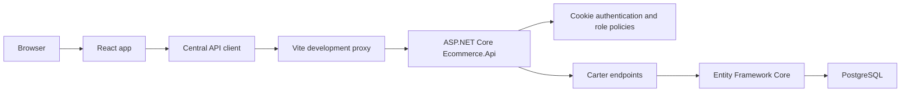

# How It Works

## Architecture

`Ecommerce.Main` provides the React storefront and administrator interface. All authentication and data operations go through the centralized client in `src/api.ts` to `Ecommerce.Api`.



## Authentication

The API handles registration, email verification, login, logout, current-user lookup, password changes, and password recovery. Sessions use an HttpOnly cookie. The Vite proxy adds the demo `X-Api-Key` header on local development requests so browser code does not contain the API key. Administrator endpoints additionally require the Admin role. Notifications are stored in the API and shown in the storefront notification center.

In Development, verification codes and password-reset links are returned to support local testing. Outside Development, SMTP must be configured. Credential challenges are currently stored in process memory.

## Data and persistence

The API uses PostgreSQL via `ConnectionStrings__EcommerceDb`; Development falls back to `Host=localhost;Database=ecommerce`, and other environments require an explicit connection string. EF Core migrations are applied at startup. Persist and share the Data Protection key ring (`DataProtection__KeyRingPath`) across API instances. The storefront keeps its cart in browser localStorage, scoped to the signed-in user, and submits orders through the API. The API enforces customer ownership, configured unit prices, and province-specific availability during checkout.

## Run locally

From the repository root:

```powershell
dotnet run --project Ecommerce.Api --urls http://127.0.0.1:5001
```

In another terminal:

```powershell
cd Ecommerce.Main
npm install
npm run dev
```

The Vite server runs on port 5173 and proxies `/api` requests to the API on port 5001.
