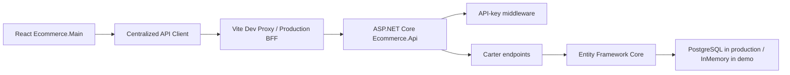

# HOW IT WORKS

## 1. Project Overview

`Ecommerce.Api` owns HTTP contracts, validation, authorization, data access, and business operations. `Ecommerce.Main` provides the React storefront. PostgreSQL should be the API's database, but the current repository uses EF Core InMemory and is therefore process-local.

## 2. System Architecture



## 3. Project Structure

- `Ecommerce.Main/src/api.ts`: centralized HTTP client and typed feature calls.
- `Ecommerce.Main/src/App.tsx`: storefront, cart, and location UI.
- `Ecommerce.Main/src/main.tsx`: React and TanStack Query providers.
- `Ecommerce.Main/src/test`: Vitest and Testing Library tests.
- `Ecommerce.Api/Program.cs`: service registration, seed data, middleware, CORS, and Swagger.
- `Ecommerce.Api/Features`: Carter endpoint vertical slices.
- `Ecommerce.Api/Data/AppDbContext.cs`: EF Core entity configuration.
- `Ecommerce.Api/Middleware`: API-key, idempotency, and exception handling.

## 4. Application Startup

Restore and build .NET dependencies, run the API, install frontend dependencies, then run Vite. The Vite server proxies `/api` to `127.0.0.1:5001` and adds the development API key server-side.

## 5. Frontend Architecture

The frontend uses React, TypeScript, Vite, TanStack Query for server state, Zod for payload validation, localStorage for the demo cart, and a single centralized API client.

## 6. Backend Architecture

Carter route modules expose versioned endpoints. EF Core InMemory acts as a repository in the demo. Exception and API-key middleware provide controlled errors and route protection.

## 7. API Communication

Browser components invoke feature calls through `ecommerceApi`, which uses `fetch`, a 15-second timeout, cancellation support, JSON handling, and typed error envelopes.

## 8. Shared API Contracts

The actual Swagger document is available at `/swagger/v1/swagger.json`. Generate declarations with `npm run generate:api` while the API is running. Generated output belongs under `src/services/generated/`.

## 9. Authentication and Authorization

The API currently has no login/session/JWT flow and does not implement role-protected endpoints. Its static `X-Api-Key` demo middleware protects API routes. The React app uses the Vite server proxy and does not expose the key to browser JavaScript. Production requires an authenticated backend proxy or replacement secret-management and authorization strategy.

## 10. Database Architecture

The API is configured with `UseInMemoryDatabase("EcommerceDb")`. PostgreSQL is not implemented in this repository. EF entities include product/category, location hierarchies, customers, orders, order details, users, and cart items.

## 11. Data Flow

React UI -> feature call -> centralized client -> Vite proxy -> API middleware -> Carter endpoint -> EF Core -> InMemory database -> JSON response -> TanStack Query/UI.

## 12. Error Handling

The frontend normalizes HTTP failures into `EcommerceApiError` with status, title, and API detail. Network and timeout failures receive explicit UI errors. The backend returns `ErrorEnvelope` records and does not expose exception stack traces.

## 13. Pagination, Filtering, and Sorting

List endpoints accept `page`, `pageSize`, and `search`. Some endpoints support resource-specific filters such as `categoryId`, `provinceId`, `cityId`, and `userId`. The frontend relies on backend pagination metadata.

## 14. Environment Configuration

Copy `.env.example` to `.env.local`. `VITE_ECOMMERCE_API_URL` defaults to `/api/v1` and should remain same-origin in production. Never place private API secrets in Vite variables.

## 15. Running the Application

```bash
dotnet restore Ecommerce.sln
dotnet build Ecommerce.sln
dotnet run --project Ecommerce.Api --urls http://127.0.0.1:5001

cd Ecommerce.Main
npm install
npm run dev
```

Then open `http://127.0.0.1:5173`.

## 16. Adding New Features

Add or verify an endpoint in the API, confirm Swagger contracts, extend the typed API client, add a feature hook/query, implement the UI, then add tests and documentation.

## 17. Testing

Run `dotnet test Ecommerce.sln` for API integration tests and `npm test` for frontend tests. Playwright is not configured because no browser automation requirement or baseline existed.

## 18. Deployment

Deploy the API behind HTTPS with explicit CORS origins, replace InMemory storage with PostgreSQL, use server-side credentials or a real identity provider, and serve the Vite build behind a reverse proxy or BFF.

## 19. Troubleshooting

- A 401 means the API-key proxy/header configuration is missing.
- A CORS failure usually indicates the frontend origin is not in the API's explicit allowed list.
- Lost data after API restart confirms InMemory database behavior.
- A Swagger generation failure means the API is not running or is not exposing Swagger.

## 20. Maintenance

Update DTOs and endpoints in the API first, verify Swagger, regenerate frontend contracts, run both test suites, and update the integration documents.
