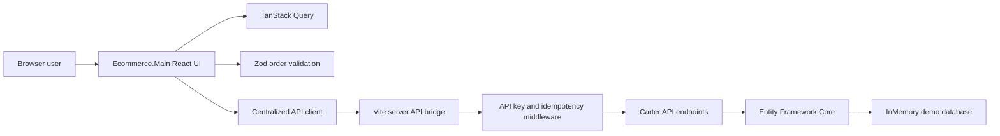

# Ecommerce Solution

A versioned ASP.NET Core 8 e-commerce API and a React/TypeScript storefront in one .NET solution. `Ecommerce.Api` owns business rules, data access, validation, Swagger contracts, and the API-key demo authentication layer. `Ecommerce.Main` provides the browser storefront and communicates only through HTTP.

## Repository structure

| Project | Purpose |
|---|---|
| `Ecommerce.Api` | Carter vertical-slice REST API, EF Core InMemory database, Swagger, rate limiting, idempotency, CORS, and demo seed data |
| `Ecommerce.Main` | React 18, JavaScript storefront (Base44) plus a TypeScript Ecommerce.Api integration route, TanStack Query, Zod, and Vitest |
| `Ecommerce.Api.Client` | Reusable typed .NET `HttpClient` wrapper |
| `Ecommerce.ConsoleClient` | .NET console API client sample |
| `Ecommerce.WebClient` | ASP.NET Core Razor Pages API client sample |
| `Ecommerce.Api.Tests` | xUnit/WebApplicationFactory API integration tests |

## Architecture



PostgreSQL is not currently configured. The API uses `Microsoft.EntityFrameworkCore.InMemory`, so data resets whenever the API process restarts.

## Integrated features

- Versioned API routes under `/api/v1`
- Product search and pagination
- Product and category contract models
- Province, city, and barangay cascading selection
- Browser-local shopping cart
- Zod-validated order submission
- Idempotency header for order creation
- Structured API error envelopes
- Request timeout and cancellation handling
- TanStack Query caching and mutation invalidation
- Swagger/OpenAPI contract generation
- Responsive desktop and mobile storefront layout
- Existing Base44 storefront preserved at `/store`; the API-backed demo storefront is available at `/api-store`

The demo cart is browser-local and is not yet synchronized with the API's cart-item endpoints. Product prices are demo values because the current product DTO and seed data do not expose a complete unit-price model.

## API authentication

Protected API routes require:

```http
X-Api-Key: demo-api-key-12345
```

This is a demo mechanism, not a production user-authentication or authorization system. The API currently has no JWT, login, session, role enforcement, or permission model. The Vite development bridge adds the demo header server-side and browser JavaScript should not contain the credential.

Never use the demo API key or plain-text user password design as production authentication.

## Prerequisites

- .NET 8 SDK
- Node.js and npm
- A modern browser

## Restore and build

Restore the complete solution and build all .NET projects:

```bash
dotnet restore Ecommerce.sln
dotnet build Ecommerce.sln
```

Install frontend dependencies and build the production bundle:

```bash
cd Ecommerce.Main
npm install
npm run build
```

## Run the application

Start the API in Development mode so Swagger is enabled:

```bash
ASPNETCORE_ENVIRONMENT=Development dotnet run --project Ecommerce.Api --urls http://127.0.0.1:5001
```

In a second terminal, start the frontend:

```bash
cd Ecommerce.Main
npm run dev -- --host 127.0.0.1
```

- Frontend: `http://127.0.0.1:5173`
- API: `http://127.0.0.1:5001`
- Swagger UI: `http://127.0.0.1:5001/swagger`
- OpenAPI JSON: `http://127.0.0.1:5001/swagger/v1/swagger.json`

## Frontend environment

Copy the example file:

```bash
cp Ecommerce.Main/.env.example Ecommerce.Main/.env.local
```

The current `VITE_ECOMMERCE_API_URL` default is `/api/v1`. Keep this same-origin so development requests pass through the Vite server bridge. Vite variables are public and must never contain private credentials or database secrets.

## Generate TypeScript API contracts

Start the API, then run:

```bash
cd Ecommerce.Main
npm run generate:api
```

The command generates `src/services/generated/ecommerce-api.d.ts` from the live Swagger document. Generated files are not manually edited; regenerate them after API contract changes.

The handwritten service at `src/api.ts` remains the runtime HTTP boundary until generated request functions are adopted throughout the application.

## Tests

Run backend integration tests:

```bash
dotnet test Ecommerce.sln
```

The xUnit tests verify successful versioned product responses and rejection of requests with a missing API key.

Run frontend tests:

```bash
cd Ecommerce.Main
npm test
```

The Vitest/Testing Library suite verifies the primary storefront render and API-product integration boundary.

## API documentation

Main API resources include:

- `/api/v1/products`
- `/api/v1/categories`
- `/api/v1/provinces`
- `/api/v1/cities`
- `/api/v1/barangays`
- `/api/v1/customers`
- `/api/v1/orders`
- `/api/v1/cart-items`
- `/api/v1/users`
- `/api/v1/unit-of-measures`
- `/api/v1/unit-prices`
- `/api/v1/customer-classes`
- `/api/v1/areas-available`

See `Ecommerce.Main/API_INTEGRATION.md` for endpoint status and mappings.

## Project documentation

- `Ecommerce.Main/HOW_IT_WORKS.md` — frontend and backend architecture
- `Ecommerce.Main/INTEGRATION_PLAN.md` — audit, progress, risks, and implementation boundaries
- `Ecommerce.Main/API_INTEGRATION.md` — endpoint mapping and integration status
- `Ecommerce.Api/ARCHITECTURE.md` — API architecture notes
- `Ecommerce.Api/HOW_IT_WORKS.md` — API behavior notes

## Production readiness and limitations

Before production:

- Replace EF Core InMemory with PostgreSQL and Npgsql.
- Add and run EF Core migrations.
- Replace the static API key with real authentication and role/permission authorization.
- Move demo users and plain-text passwords out of seed code.
- Configure production CORS origins explicitly.
- Serve the API through HTTPS.
- Add real product unit prices and backend inventory calculations.
- Synchronize cart state with the API and authenticated user.
- Add complete frontend CRUD flows only for supported backend endpoints.
- Add backend integration, authorization, transaction, frontend end-to-end, and browser tests.
- Replace browser-local checkout values with server-authoritative pricing and inventory rules.

## Verification

Current verification results:

- `dotnet build Ecommerce.sln` succeeds with no warnings
- `dotnet test Ecommerce.sln` passes 2 API integration tests
- `npm test` passes the frontend Vitest suite
- `npm run build` produces the React production bundle successfully
